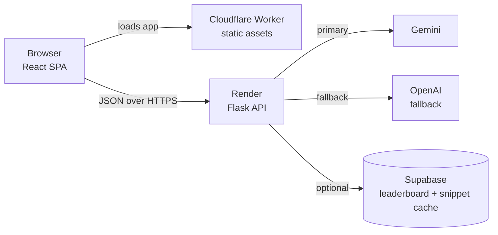

# Lyric Match

**A song-guessing game: read two to four lines of lyrics, name the song. English and romanised Hindi, 13 packs, about 2,000 songs.**

Play it: **https://lyrics-match.driptobhattacharyya.com**

<!-- screenshot -->

## What makes it interesting

- **The answer never reaches the browser.** Each round is an encrypted, expiring token. The client holds only the lyrics, a title mask (`_____ __ ___`) and the token; the title is sent back only once the round is over.
- **Tamper-resistant leaderboard.** The server computes each round's points itself, measuring elapsed time from when it issued the round, and signs them into a receipt. A score submission is just the list of receipts. The server verifies them, recomputes the streak multiplier, rejects mixed modes, stale rounds (over an hour old) and resubmitted games, and only then writes the score. The client cannot post an arbitrary number.
- **LLM cost controls.** Snippets are generated on demand, cached (in memory, optionally in a local file and in Supabase) and reused, with up to 3 variants per song. A global daily cap (`MAX_LLM_CALLS_PER_DAY`, default 200) falls back to cached snippets only. Per-IP rate limits apply to every route, CORS is an allowlist, and request bodies are capped at 16 KB.
- **Provider fallback.** Gemini is tried first; if it fails or is unavailable, OpenAI is used. With neither, the API returns a clean `503 llm_unavailable` (stored snippets still work).
- **Cold-start handling.** The backend runs on a free tier that sleeps. The frontend shows a warming screen and keeps polling `/healthz` (a cheap endpoint with no LLM or database call) until the API answers.
- **Romanised Hindi, tolerant matching.** Lyrics and titles are always in Latin script. Guesses are normalised and fuzzy-matched (RapidFuzz) so that spelling variants of romanised Hindi still count.
- **Works without a database.** With no Supabase configured the game is fully playable and the leaderboard is simply switched off (`/api/meta` reports `leaderboard: false`).

## Gameplay

- 8 rounds per game, 3 hearts, pick any combination of packs.
- **Easy** (multiple choice, four options, 20 s per round) and **Pro** (type the title, 45 s per round).
- Hints: letter reveals in three cumulative levels (-15 points per level) and an artist hint (-20).
- Scoring: a correct round is `100 + speed bonus (up to 50) - hint penalty`, at least 10. Consecutive correct rounds add a streak multiplier of +0.1 each, capped at x1.5.
- Local progression stored in the browser: XP and levels, a daily play streak, best scores, and nine badges (First Note, On Fire, Flawless, Ear Only, Speed Demon, Platinum, Groove Habit, Polyglot, No Sweat).
- Global leaderboard (all time, week, day) per mode, when the backend has Supabase configured.

## Architecture



Full endpoint reference: [docs/api.md](docs/api.md).

## Tech stack

| Part | Stack |
| --- | --- |
| Frontend | React 19, TypeScript, Vite, Tailwind CSS 4, Motion, Bun, ESLint, hosted on Cloudflare Workers (static assets) |
| Backend | Python 3.13, Flask, Gunicorn, Flask-Limiter, flask-cors, `cryptography` (round tokens), RapidFuzz, httpx2 |
| LLMs | Google Gemini (primary), OpenAI (fallback) |
| Data | Supabase Postgres via PostgREST (optional), JSON song catalogue in the repo |
| CI | GitHub Actions: ruff, pytest, catalogue validation, ESLint, bun test, build |

## Repo layout

```
backend/            Flask API (see backend/README.md)
  lyric_match/      app code, song catalogue (catalog/*.json)
  scripts/          pregenerate.py, validate_catalog.py
  supabase/         schema.sql
  tests/
frontend/           React app (see frontend/README.md)
  src/              screens, components, game rules and reducer
  tests/mock-api/   standalone mock of the API for UI work
docs/               api.md, deploy.md
render.yaml         Render blueprint for the backend
.github/workflows/  CI
```

## Quick start (local)

Backend, with placeholder lyrics and an in-memory leaderboard (no keys, no database):

```bash
cd backend
python -m venv .venv && source .venv/bin/activate
pip install -r requirements-dev.txt
cp .env.example .env
# in .env set: FAKE_LLM=1, FAKE_DB=1 and any long random SECRET_KEY, e.g.
#   python -c "import secrets; print(secrets.token_urlsafe(32))"
flask --app app run --port 5000
```

Frontend (needs [Bun](https://bun.sh)); it talks to `http://localhost:5000` by default:

```bash
cd frontend
bun install
bun run dev        # http://localhost:5173
```

To use real lyrics locally, put `GEMINI_API_KEY` and/or `OPENAI_API_KEY` in `backend/.env` and set `FAKE_LLM=0`.

## Testing

```bash
# backend
cd backend && ruff check . && pytest && python scripts/validate_catalog.py

# frontend
cd frontend && bun run lint && bun test && bun run build
```

The same commands run in CI on every push and pull request. For UI work without the backend, `node frontend/tests/mock-api/server.mjs` serves a mock API on port 5055 (set `VITE_API_URL=http://localhost:5055`).

## Deployment

Step-by-step guide for Supabase, Render and Cloudflare Workers: [docs/deploy.md](docs/deploy.md).

## Security notes

- Secrets live only as environment variables on Render: `GEMINI_API_KEY`, `OPENAI_API_KEY`, `SUPABASE_SERVICE_ROLE_KEY` and `SECRET_KEY` (Render generates the latter). Nothing secret is in the frontend bundle or the repo; `.env` files are git-ignored and only `.env.example` templates are committed. The only frontend setting, `VITE_API_URL`, is a public URL.
- Supabase tables have row level security enabled with no policies, so the public anon key can read and write nothing. Only the backend, using the service-role key, touches the data.
- Round tokens are encrypted and expire after 15 minutes; receipts are signed, so neither can be forged or read by the client.
- Set spend caps and alerts in the Gemini and OpenAI consoles as a second line of defence behind the in-app daily budget and rate limits.

## About the content

Lyric snippets are short excerpts generated on demand by an LLM and cached. This repository contains no lyrics: the catalogue holds only titles, artists, years and genres.

## License

[MIT](LICENSE) © 2025-2026 Dripto Bhattacharyya ([@driptobhattacharyya](https://github.com/driptobhattacharyya))
